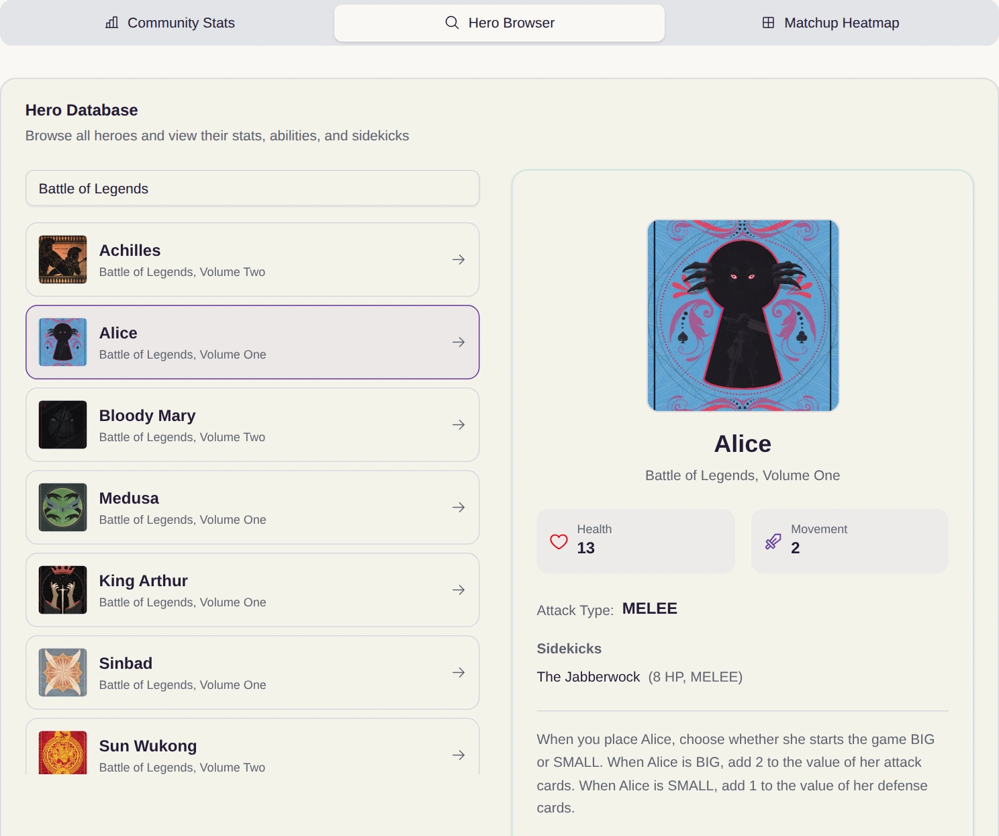
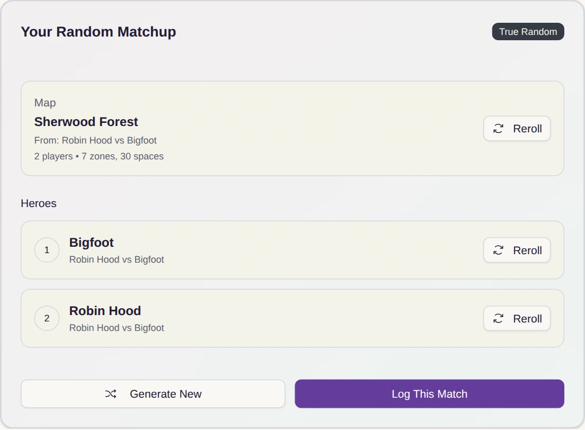

# Unmatched Tracker

[](https://unmatched-tracker.vercel.app)
[](https://github.com/Giffdev/unmatched-match-trac/actions/workflows/tests.yml)
[](LICENSE)

Does Medusa always beat Alice at your table, or do you just remember the last
game? Unmatched Tracker is a companion to the [Unmatched board game](https://restorationgames.com/unmatched/).
Keep a record of who played whom and where, see how your results compare with
other tables, or let the tracker pick tonight's fighters from the boxes you own.

**[Open Unmatched Tracker](https://unmatched-tracker.vercel.app)** · [Run it locally](#local-development)

## Features

### Try it without an account

Open the app and scroll past the sign-in form. Three tabs are ready to explore:

- **Hero Browser:** Search for a fighter or a set. Open Alice to see her health,
  movement, and melee attack, meet the Jabberwock, and read how her ability
  changes when she's big or small.
- **Matchup Heatmap:** Read from the row fighter to the column opponent. Where
  Alice's row meets Medusa's column, the percentage is *Alice's* win rate in
  logged 1v1 games. Hover over a cell on desktop to see the wins and total
  games behind it: one win in one duel tells a different story than ten in ten.
- **Community Stats:** See which heroes people play most, which have the
  highest recorded win rates, and which maps make it to the table most often.



### From the shelf to the scorebook

Sign in with Google or email and password to save your own games and collection.
Set your player name in your profile to match the one you use in the log;
**Players** will open on your record. On a phone, the dashboard tabs run along
the bottom, within reach at the table.

1. **Manage your collection.** In **Manage Collection** (**Collection** on mobile),
   check the sets and battlefield accessories you own. Filter by franchise if
   you're looking for a particular box.
2. **Randomize your matchup.** In **Randomizer**, choose a game mode and generate
   fighters and a map for that player count. Stick to your collection or use the
   full catalog. Like the fighters but not the battlefield? Reroll just the map.
   Expand **Randomization pool** to choose a subset of owned sets and filter
   both random fighters and maps without changing your collection.
   Use the lock icon on a generated fighter or map to keep it
   while generating the others. Locked fighters and maps stay fixed even outside the
   selected pool; changing game mode clears locks. Empty pools, too few
   distinct fighters, or no suitable map show an error instead of using
   excluded sets.
   Hover, focus, or tap the lock icon for an explanation of its current state.
   For a duel, **Balanced** uses community 1v1 results to suggest a close
   matchup and shows how confident the suggestion is.
3. **Record the result.** Choose **Log This Match** to keep the generated
   fighters, map, and mode, or start from **Matches → Log Match** for a game you
   set up yourself. Record the date, players, and turn order. Log a winner or
   draw for a duel, 2v2, or three- or four-player free-for-all; for a cooperative
   game, record whether the table won or lost. You can edit or delete games in
   your personal history.



*A draw from the Robin Hood vs Bigfoot box. Keep the fighters and reroll just
Sherwood Forest, or take this lineup straight to the match log.*

Already track games in a spreadsheet? Choose **Import from CSV** in your
profile menu. The importer suggests columns for the map, fighters, players,
and result. You can adjust the mappings, preview rows, and review errors
before adding anything to your history.

### What can your match history tell you?

| At the table | Where to look |
| --- | --- |
| Which fighters are still sitting in my boxes? | **Players** lists the heroes and maps a player has never played. Filter those lists to owned sets, or check the player's most-played picks and head-to-head records. |
| Is Alice struggling against Medusa everywhere, or just here? | **Heroes** breaks down a fighter's results by opponent, with your record alongside the community's. |
| We've got four players tonight. Which board should we try? | **Maps** filters battlefields by supported player count. Open one to see recent games and how each hero has fared on that map at your table and across the community. |

### Keep a shared game-night log

Create a group and invite friends with a link, or search for them by email or
player name. When logging a new game, select **Also log to group(s)** to keep
it in your history and add it to the group's. For games you've already played,
open the group and choose **Import Matches** to copy just the ones you want.

On **Matches**, **Players**, and **Heroes**, switch from **My Matches** to the
group name to see that table's shared history and stats. Joining a group
doesn't copy your back catalog or pool everyone's collections.

## Technology

- React 19 and TypeScript
- Vite 7 with SWC
- Tailwind CSS 4 and Radix UI components
- Firebase Authentication and Cloud Firestore
- Vitest, Testing Library, and Firebase Emulator Suite rules tests
- Vercel hosting

## Local development

### Prerequisites

- Node.js 20.19+ or 22.12+
- npm
- A Firebase project with Authentication and Cloud Firestore configured

### Setup

```bash
git clone https://github.com/Giffdev/unmatched-match-trac.git
cd unmatched-match-trac
npm ci --legacy-peer-deps
```

Copy `.env.example` to `.env.local` and provide the Firebase web application
configuration:

```dotenv
VITE_FIREBASE_API_KEY=
VITE_FIREBASE_AUTH_DOMAIN=
VITE_FIREBASE_PROJECT_ID=
VITE_FIREBASE_STORAGE_BUCKET=
VITE_FIREBASE_MESSAGING_SENDER_ID=
VITE_FIREBASE_APP_ID=
```

Then start the development server:

```bash
npm run dev
```

Vite prints the local URL when the server starts.

## Available scripts

| Command | Purpose |
| --- | --- |
| `npm run dev` | Start the Vite development server |
| `npm run build` | Compile the TypeScript project and create a production build |
| `npm run preview` | Serve the production build locally |
| `npm test` | Run the Vitest unit and component test suite once |
| `npm run test:watch` | Run Vitest in watch mode |
| `npm run test:rules` | Test Firestore security rules with the Firebase emulator |

`npm run test:rules` requires Java and the Firebase CLI (`firebase-tools`) in
addition to the normal project dependencies.

## Data and deployment

Firebase handles sign-in and stores the game records. Only you can change your
personal match log and collection, but the match records used for community
statistics are publicly readable. Adding a game to a group doesn't make the
original record private.

The production site is deployed to Vercel. `vercel.json` rewrites application
routes to the SPA entry point, and the repository includes a manually
triggered production deployment workflow.

## License and game attribution

The repository is available under the [MIT License](LICENSE).

Unmatched Tracker is an unofficial fan project. It is not affiliated with or
endorsed by Restoration Games, Mondo Games, or the owners of any characters
and properties represented in Unmatched. Unmatched and related names and
artwork belong to their respective owners.
